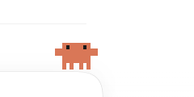
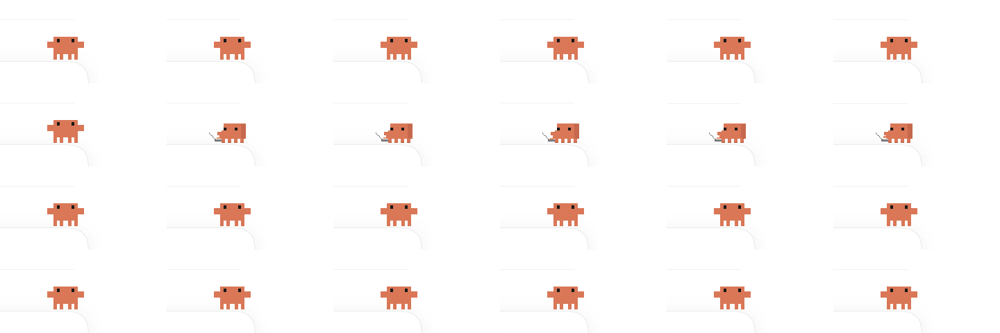
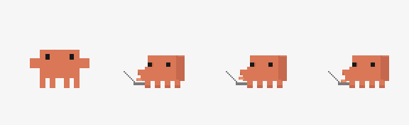

<div align="center">

# dsh-claude-clawd

**给 DeepSeek Harness 输入框加一个会敲键盘的 Claude 小人**


</div>

---

## 这是什么

一个 56×40 的像素小人，挂在 DeepSeek Harness 输入框的右上沿。

它不是独立窗口，也不是桌面宠物程序，而是 DeepSeek Harness 的 **client plugin**：注册在 `conversation.input.overlay` 槽位，脚底贴住输入框上边线，随输入框布局移动。它只做一件事——把当前会话的思考状态翻译成两个动作：

- **没在想**：正面站立，双臂展开，四条短腿，没有电脑。
- **正在想**：侧身朝左，身前出现一条灰色折线小电脑，手部轻轻敲击。

正文、工具调用、授权等待、取消、报错、断线和状态未知，都会回到正面待机。

它不创建独立进程，不置顶，不使用 `SetParent`，不读窗口标题，也不按标题前缀匹配会话。

## 效果

| 状态 | 画面 |
| :--- | :--- |
| 待机 | 正面、无电脑，脚底贴在输入框上边线 |
| 思考 | 侧身朝左，灰色折线电脑出现在左前方，手部 1px 上下敲击 |
| 正文 / 工具 / 授权 / 取消 / 报错 / 断线 | 正面待机，电脑消失 |



实际位置：输入框右上沿，脚贴输入框上边线；鼠标事件穿透，不会挡住输入、发送和附件按钮。

思考时的连续帧：



素材本身是透明 PNG，不包含白色背景或光晕：



## 安装

| 项目 | 要求 |
| :--- | :--- |
| 系统 | Windows 10 / 11 |
| 目标应用 | DeepSeek Harness 桌面版 **0.2.1-rc.2** |
| 运行时依赖 | 无（PowerShell 5.1 即可） |
| 权限 | 一般不需要管理员权限 |

```powershell
git clone https://github.com/Ayanami-lppl/dsh-claude-clawd.git
cd dsh-claude-clawd
.\setup.cmd
```

如果 PowerShell 执行策略拦截 `.cmd`，可以直接运行：

```powershell
powershell -NoProfile -ExecutionPolicy Bypass -File .\setup.ps1
```

安装器做四件事，全部可逆：

1. 把 `v2-plugin/` 复制到 `%USERPROFILE%\.dsh\profiles\desktop\node_modules\dsh-claude-pet`；
2. 备份 `cordis.patch.yml`，再加入 `claude-pet-v2` 注册行；
3. 如果检测到旧版独立挂件或旧的 Host 桥接，会停用并归档，不会同时运行两套；
4. **不修改 DeepSeek Harness 安装目录**，不写 `app.asar`，不注入进程。

安装完成后，**完全退出 DeepSeek Harness 再重新打开**（不是只刷新页面）。小人会出现在输入框右上沿。

安装后可以运行：

```powershell
powershell -NoProfile -ExecutionPolicy Bypass -File .\verify.ps1
```

检查插件文件、patch 行、旧独立挂件是否已清理。

## 使用

安装后不需要启动任何其他程序，也没有托盘图标或右键菜单。

- **待机**：正面、无电脑。
- **当前会话进入 reasoning**：侧身、出现灰线电脑、手部轻敲。
- **正文出现**：立刻回正面。
- **工具执行 / 授权等待 / 取消 / 报错 / 断线**：保持正面，不敲键盘。
- **切换会话**：组件按 `sessionId` 重绑，后台会话的状态不会串到当前输入框。

### 它不会

- 创建独立窗口、置顶窗口或开机启动项；
- 抢输入焦点、增加 Tab 停靠点或拦截鼠标；
- 读取或上传聊天正文、推理正文、工具参数；
- 按窗口标题或标题前缀猜会话；
- 在状态未知时伪造“正在思考”。

## 工作原理

```text
DeepSeek Harness
└─ InputBar
   └─ conversation.input.overlay
      └─ dsh-claude-pet
         ├─ 读取 ctx.sessions.binding(sessionId).eventSource
         ├─ 扫描 assistant/live-chunk
         └─ 渲染 56×40 的 idle / typing PNG
```

状态只来自当前会话的前端实时流：

| 事件 | 结果 |
| :--- | :--- |
| `reasoning-delta` 非空白 | thinking（侧身敲击） |
| `text-delta` 非空白 | responding（正面 idle） |
| `tool-call-delta` | tool（正面 idle） |
| `approval/asked` | waiting（正面 idle） |
| `turn/end` / `step/end` / `assistant/message` | idle（正面） |
| 6 秒没有新事件 | idle（防卡死） |

不建立本机 TCP 桥接，不读标题，不修改 DSH 的会话数据。详细接入说明见 [`docs/V2-ARCHITECTURE.md`](docs/V2-ARCHITECTURE.md)。

## 素材与自定义

透明帧在 `v2-assets/frames/`：

```text
idle.png           正面、无电脑
typing-rest.png    侧身、手在中间
typing-left.png    侧身、手偏上
typing-right.png   侧身、手偏下
frames.json        56×40 画布、脚底锚点、帧序、140ms/帧
```

三个 typing 帧来自**同一张侧身母版**，只移动手部；电脑、脚底和身体不漂移。

### 重新生成素材

需要 Python 3 和 Pillow（仅开发时需要，运行时不需要）：

```powershell
python tools/make_v2_assets.py
python tools/build_v2_client.py
.\setup.cmd
```

`make_v2_assets.py` 会从 `v2-assets/source/claude-pose-source.png` 重新抠图、量化、对齐脚底基线，并生成透明帧和预览；`build_v2_client.py` 会把 PNG 以 data URL 嵌入 `v2-plugin/lib/client.js`。

### 改位置 / 大小 / 颜色

- **位置**：改 `v2-plugin/client.template.js` 里的 `right: "4px"`，然后重新运行上面三条命令。
- **大小**：当前画布固定为 56×40。改大小时要同步改 CSS 的 `width` / `height` 和 `frames.json` 的锚点，并重新生成素材；不建议只缩放 CSS，会破坏像素边缘。
- **颜色**：改 `tools/make_v2_assets.py` 顶部的调色板，重新生成素材。
- 改完必须重新运行 `setup.cmd` 并重启 DSH，应用里才会加载新图。

## 目录结构

```text
dsh-claude-clawd/
├─ setup.cmd / setup.ps1         安装与旧版迁移
├─ uninstall.cmd / uninstall.ps1 卸载
├─ verify.ps1                    安装检查
├─ v2-plugin/
│  ├─ package.json               dsh.client platform web
│  ├─ client.template.js         客户端组件源码模板
│  └─ lib/
│     ├─ index.js                Host 侧空壳
│     └─ client.js               生成物，内嵌图片 data URL
├─ v2-assets/
│  ├─ frames/                    运行时透明 PNG
│  ├─ frames.json                画布与帧序
│  ├─ preview-*.png / .gif       预览
│  └─ source/                    四格源图与参考截图
├─ tools/
│  ├─ make_v2_assets.py          素材生成
│  └─ build_v2_client.py         把 PNG 嵌入客户端
├─ docs/
│  ├─ V2-ARCHITECTURE.md         slot、状态源、会话绑定
│  ├─ ROLLBACK.md                备份与回滚
│  └─ evidence/                  真实 DSH 截图
├─ assets/social-preview.png     GitHub 社交预览图（1280×640）
└─ ACCEPTANCE.md                 验收记录
```

## 常见问题

<details>
<summary><b>重启后没看到小人？</b></summary>

按顺序检查：

1. 插件目录存在：`%USERPROFILE%\.dsh\profiles\desktop\node_modules\dsh-claude-pet\lib\client.js`
2. `cordis.patch.yml` 末尾有：
   ```yaml
   - insert:
       - id: claude-pet-v2
         name: dsh-claude-pet
   ```
3. 完全退出 DeepSeek Harness 再打开；只按 Ctrl+R 不一定能清掉旧的页面模块
4. 运行 `verify.ps1`
5. 如果还看不到，重新运行 `setup.cmd`，再重启
</details>

<details>
<summary><b>小人会挡住输入、发送或附件按钮吗？</b></summary>

不会。组件挂在输入框外壳上边线之外，尺寸只有 56×40；wrapper 和 img 都是 `pointer-events: none`，并且带 `aria-hidden`。点击、选中、滚动都穿透到 DSH 自己的控件。
</details>

<details>
<summary><b>为什么没有托盘、右键菜单或独立窗口？</b></summary>

这是刻意设计。独立窗口需要置顶、坐标同步或 `SetParent`，容易挡住聊天窗口，也会和 DSH 的输入焦点打架。这一版是 DSH 界面内的 React 组件，随输入框一起布局，没有独立进程。
</details>

<details>
<summary><b>支持其他 DeepSeek Harness 版本吗？</b></summary>

当前按 **0.2.1-rc.2** 的 `conversation.input.overlay`、`ctx.sessions.binding` 和 `assistant/live-chunk` 实现。其他版本如果没有这些 slot/事件，组件会不渲染或保持 idle，不会伪造思考。
</details>

<details>
<summary><b>为什么只有思考时才有电脑？</b></summary>

这是角色的状态语言：电脑代表 reasoning，正文和工具阶段不是在“想”，所以收起电脑、回到正面。所有非 thinking 状态都不会出现敲键盘动画。
</details>

<details>
<summary><b>为什么仓库里没有原始录屏？</b></summary>

录屏里包含真实应用界面，公开仓库不分发；仓库保留四格源图和参考截图，足够复现透明帧。透明 PNG、预览 GIF 和生成脚本都在。
</details>

<details>
<summary><b>怎么卸载干净？</b></summary>

```powershell
.\uninstall.cmd
```

它会移除 `dsh-claude-pet` 插件目录和 `claude-pet-v2` patch 行，并在 `%LOCALAPPDATA%\ClaudeKeyboardWidget\backup\` 留备份。重启 DSH 后完全恢复原样。
</details>

## 已知限制

- 只在 Windows 10/11、DeepSeek Harness 0.2.1-rc.2 上做过视觉验证。
- 尚未逐项复现：取消、报错、授权等待、两个真实会话切换、多行输入增高、侧栏开合、125%/150% DPI、明暗主题切换、卸载后重装。
- 这是界面装饰层，不参与 DSH 的输入、发送、附件或会话逻辑。
- 角色是像素同人素材，不是 DeepSeek 或 Anthropic 的官方资源。

## 卸载 / 回滚

```powershell
.\uninstall.cmd
```

备份位置：

```text
%LOCALAPPDATA%\ClaudeKeyboardWidget\backup\v2-migration-<时间戳>\
```

包含旧的 `cordis.patch.yml`、旧独立挂件和旧 Host 插件目录。手动恢复步骤见 [`docs/ROLLBACK.md`](docs/ROLLBACK.md)。

## 免责声明

- 本项目是**非官方粉丝向作品**，与 DeepSeek、Anthropic 均无隶属关系。
- “Claude”角色形象参考自 Anthropic 的 Claude；相关名称与角色权利归 Anthropic 所有。仓库中的像素图是基于参考重新绘制的同人素材，不含官方素材文件，仅用于个人桌面美化，请勿商用。
- DeepSeek Harness 及其相关名称归 DeepSeek 所有。
- 本项目按“现状”提供，不保证适配未来版本的 DSH；使用本插件造成的界面异常，可以通过 `uninstall.cmd` 回滚。

## License

[MIT](LICENSE)
